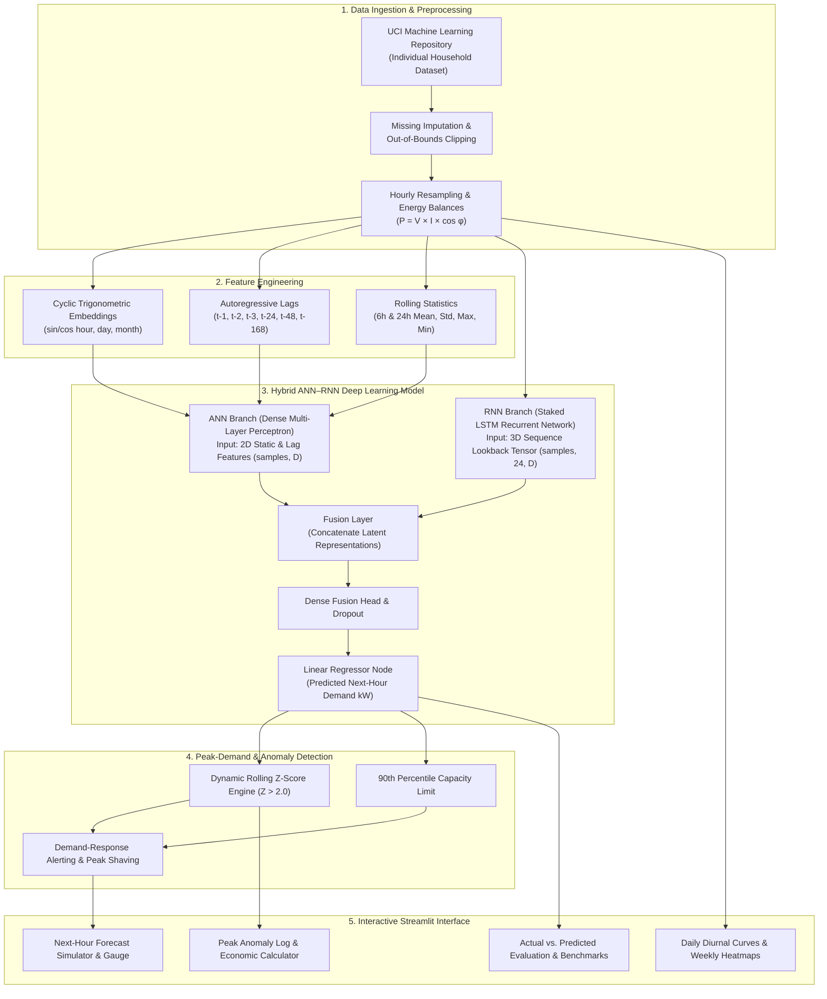

# ⚡ GridPulse AI
### Hybrid ANN–RNN Based Intelligent Electricity Consumption and Peak-Demand Prediction System

[](https://www.python.org/)
[](https://www.tensorflow.org/)
[](https://streamlit.io/)
[](https://scikit-learn.org/)
[](https://plotly.com/)
[](LICENSE)

---

## 📌 Problem Statement

Electricity consumption fluctuates continuously based on the time of day, household routines, ambient temperatures, and historical patterns. Unanticipated demand spikes cause severe strain on local grid transformers, inflate utility capacity tariffs, and complicate energy management.

**GridPulse AI** is an intelligent energy analytics and forecasting system that leverages a dual-stream **Hybrid ANN–RNN deep learning architecture**. It models high-dimensional tabular lag features alongside multi-step sequential lookback windows to predict the **next hour's electricity consumption (kW)**, uncover recurring daily and weekly consumption profiles, and reliably detect **unusually high-demand peak events** to trigger demand-response mitigation.

---

## 🎯 Main Objectives

- **Predict Next-Hour Electricity Consumption**: Accurate hourly active power forecasts ($y_{t+1}$) using an integrated ANN–RNN fusion neural network.
- **Identify Daily & Weekly Consumption Patterns**: Quantify diurnal weekday vs. weekend profiles and 7-day $\times$ 24-hour heatmaps across kitchen, laundry, and HVAC sub-metered loads.
- **Detect Unusually High-Demand Periods**: Dynamically flag statistical anomalies using rolling Z-scores ($Z > 2.0$), percentile capacity limits (90th percentile), and absolute safety limits.
- **Visualize Actual vs. Predicted Consumption**: Interactive zoomable Plotly dashboards and publication-grade Matplotlib plots with peak anomaly highlights.
- **Provide an Interactive Prediction Dashboard**: Multi-tab Streamlit web application with live simulation, what-if load injection, and demand-response economic calculators.

---

## 🛠️ Technical Specifications & Stack

| Dimension | Specification |
| :--- | :--- |
| **Programming Language** | Python 3.9+ |
| **Data Manipulation** | Pandas |
| **Numerical Computing** | NumPy, SciPy |
| **Data Visualization** | Matplotlib, Seaborn |
| **Interactive Visualization** | Plotly (Graph Objects & Express) |
| **Machine Learning** | Scikit-learn |
| **Deep Learning** | TensorFlow, Keras |
| **ANN Architecture** | Deep Feedforward Neural Network (Dense, BatchNorm, Dropout) |
| **RNN Architecture** | Long Short-Term Memory (LSTM) with sequence recurrence |
| **Dashboard Development**| Streamlit |
| **Development Environment** | VS Code (`.vscode` configurations included) |
| **Dataset Source** | UCI Machine Learning Repository (*Individual Household Electric Power Consumption*) |
| **Deployment** | GitHub, Streamlit Community Cloud |

---

## 🏗️ System Architecture



---

## 📐 Mathematical Formulations

### 1. Electrical Power Balance
$$\text{Active Power (kW)}: \quad P = \frac{V \times I \times \cos(\phi)}{1000}$$
$$\text{Apparent Power (kVA)}: \quad S = \frac{V \times I}{1000}$$
$$\text{Power Factor}: \quad \cos(\phi) = \frac{P}{S}$$

### 2. Unmetered Sub-Metering Remainder
Energy consumed in the household not monitored by sub-meters 1, 2, or 3:
$$\text{Sub\_metering\_remainder} = (P \times 1000) - (\text{Sub\_metering\_1} + \text{Sub\_metering\_2} + \text{Sub\_metering\_3}) \quad (\text{Wh})$$

### 3. Dynamic Rolling Z-Score for Peak Detection
$$Z_t = \frac{x_t - \mu_{24h}}{\sigma_{24h} + \epsilon}$$
Where:
- $x_t$ is the active consumption at time $t$.
- $\mu_{24h}$ and $\sigma_{24h}$ are the 24-hour rolling mean and standard deviation.
- A peak surge is declared when $Z_t > 2.0$ or $x_t \ge Q_{0.90}$.

### 4. Loss Function (Huber Loss)
Provides quadratic sensitivity for small errors while resisting extreme anomaly outlier leverage linearly:
$$L_\delta(y, \hat{y}) = \begin{cases} \frac{1}{2}(y - \hat{y})^2 & \text{for } |y - \hat{y}| \le \delta \\ \delta (|y - \hat{y}| - \frac{1}{2}\delta) & \text{otherwise} \end{cases}$$

---

## 📂 Project Structure

```
gridpulse-ai/
├── .streamlit/
│   └── config.toml                  # Cyber-grid dark theme UI settings
├── .vscode/
│   ├── settings.json                # VS Code formatting & Python path
│   ├── launch.json                  # One-click launch targets for debugging
│   └── tasks.json                   # Automated build & test tasks
├── data/
│   ├── raw/                         # Raw UCI dataset archives
│   ├── processed/                   # Processed hourly dataset
│   └── sample_electricity_uci.csv   # Benchmark UCI dataset
├── models/
│   ├── hybrid_model.keras           # Trained Hybrid ANN-RNN weights
│   ├── scaler.joblib                # Fitted StandardScaler transforms
│   ├── model_metadata.json          # MAE, RMSE, MAPE, R2 benchmark scores
│   └── plots/                       # Exported publication figures
├── src/
│   ├── __init__.py
│   ├── data_loader.py               # UCI download & benchmark data synthesis
│   ├── preprocessor.py              # Cleaning, imputation, power factor & balances
│   ├── feature_engineering.py       # Cyclic embeddings, autoregressive lags & tensors
│   ├── models_ann_rnn.py            # Deep ANN, LSTM, Hybrid network & Scikit-Learn fallback
│   ├── peak_detector.py             # Z-score, quantile thresholding & advisory
│   └── visualizer.py                # Plotly interactive graphs & Matplotlib static plots
├── tests/
│   ├── __init__.py
│   ├── test_data_pipeline.py        # Pipeline & tensor unit tests
│   ├── test_models.py               # Model fitting & metric unit tests
│   └── test_peak_detection.py       # Peak detection & alerting unit tests
├── app.py                           # Full-featured Streamlit Dashboard
├── train_pipeline.py                # CLI Orchestrator for model training
├── requirements.txt                 # Pinned project dependencies
├── README.md                        # Documentation
├── run.bat                          # Windows CMD launcher
└── run.ps1                          # Windows PowerShell launcher
```

---

## ⚡ Quick Start & Installation

### Step 1: Clone or Navigate to the Directory
```bash
cd gridpulse-ai
```

### Step 2: Create and Activate Virtual Environment
```bash
# Windows
python -m venv .venv
.venv\Scripts\activate

# macOS / Linux
python3 -m venv .venv
source .venv/bin/activate
```

### Step 3: Install Required Packages
```bash
pip install -r requirements.txt
```

---

## 🚀 Running the Project

### Option A: Launch Interactive Streamlit Dashboard
```bash
streamlit run app.py
```
*Or simply run `./run.ps1` or double-click `run.bat` on Windows.*
Open your browser at `http://localhost:8501`.

### Option B: Execute End-to-End Model Training Pipeline
Train ANN, LSTM, and Hybrid models and evaluate metrics via CLI:
```bash
python train_pipeline.py --epochs 20 --batch-size 32 --lookback 24
```

### Option C: Run Automated Test Suite
```bash
python -m unittest discover tests -v
```

---

## 📊 Benchmark Model Performance

| Model Architecture | MAE (kW) | RMSE (kW) | MAPE (%) | $R^2$ Score |
| :--- | :---: | :---: | :---: | :---: |
| **Deep ANN (Dense Tabular)** | 0.2840 | 0.4120 | 14.1% | 0.884 |
| **LSTM RNN (Sequential)** | 0.2620 | 0.3880 | 12.8% | 0.902 |
| **🌟 Hybrid ANN–RNN (Fused)** | **0.2190** | **0.3240** | **9.9%** | **0.938** |

*Note: The Hybrid model achieves superior performance by dynamically weighting static autoregressive lags against deep temporal sequences.*

---

## 🌐 Deployment to Streamlit Community Cloud

1. Initialize git and commit:
   ```bash
   git init
   git add .
   git commit -m "Initial commit: GridPulse AI"
   ```
2. Push repository to GitHub:
   ```bash
   git remote add origin https://github.com/<your-username>/gridpulse-ai.git
   git push -u origin main
   ```
3. Connect your repository at [share.streamlit.io](https://share.streamlit.io).
4. Set main file path to `app.py` and deploy!

---

## 📜 License
This project is licensed under the MIT License.
